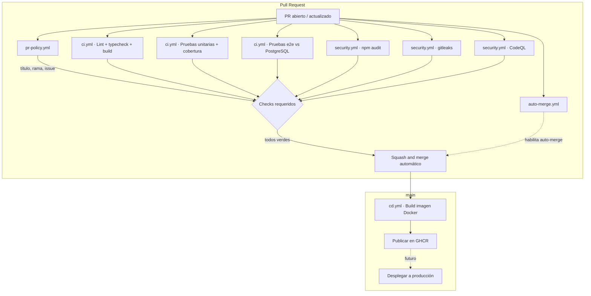

# Pipeline CI/CD

Pipeline de integración y entrega continua del Sistema CAL, basado en GitHub Actions con runners de GitHub (`ubuntu-latest`). Los PRs se validan y fusionan automáticamente cuando todas las compuertas están en verde, sin aprobación humana.

## Diagrama



## Workflows

### `ci.yml`

Se ejecuta en `pull_request` y `push` a `main`. Tres jobs en paralelo:

| Job | Qué hace |
|-----|----------|
| **Lint, typecheck y build** | `npm run lint` (oxlint), `tsc --noEmit`, `npm run build` |
| **Pruebas unitarias** | `npm run test:cov` con Vitest. Verifica que la cobertura de líneas no baje del 60%. Sube el reporte como artefacto. |
| **Pruebas e2e** | `npm run test:e2e` contra un service container de PostgreSQL 15 con credenciales de prueba. Nunca llama a Gemini ni a Gmail reales. |

### `security.yml`

Se ejecuta en `pull_request` y `push` a `main`. Tres jobs:

| Job | Qué hace |
|-----|----------|
| **npm audit** | `npm audit --audit-level=high`. Falla si hay vulnerabilidades altas o críticas. |
| **gitleaks** | Escanea el historial de commits en busca de secretos expuestos. |
| **CodeQL** | Análisis estático de seguridad para JavaScript/TypeScript. |

### `pr-policy.yml`

Se ejecuta en `pull_request` (opened, edited, synchronize, reopened). Un solo job que valida:

1. **Título del PR** sigue Conventional Commits (`feat:`, `fix:`, `docs:`, `test:`, `refactor:`, `chore:`, `hotfix:`).
2. **Nombre de la rama** sigue `<prefijo>/TKT-XXX-descripcion` con los prefijos del proyecto.
3. **Referencia a issue** en el cuerpo del PR (`Closes #N`, `Fixes #N` o `Resolves #N`).

### `auto-merge.yml`

Se ejecuta en `pull_request`. Habilita auto-merge con Squash usando `gh pr merge --auto --squash` y el `GITHUB_TOKEN`. El merge solo ocurre cuando todos los checks requeridos pasan y las reglas de protección de rama se cumplen.

### `cd.yml`

Se ejecuta en `push` a `main` (después de que CI pase). Dos jobs:

1. **Build y push**: construye la imagen Docker multi-stage y la publica en GitHub Container Registry (`ghcr.io/cambridge-cal/proyectogrado-server`).
2. **Deploy** (deshabilitado con `if: false`): desplegará a producción vía SSH cuando se defina el servidor.

## Dependabot

Configurado en `.github/dependabot.yml` para actualizar semanalmente:
- Dependencias npm
- Versiones de GitHub Actions

## Secretos y variables

| Secreto | Requerido por | Estado |
|---------|---------------|--------|
| `GITHUB_TOKEN` | Todos los workflows | Automático, provisto por GitHub |
| `DEPLOY_HOST` | `cd.yml` (deploy) | Pendiente: IP o dominio del servidor |
| `DEPLOY_USER` | `cd.yml` (deploy) | Pendiente: usuario SSH |
| `DEPLOY_KEY` | `cd.yml` (deploy) | Pendiente: clave privada SSH |
| `DEPLOY_PATH` | `cd.yml` (deploy) | Pendiente: ruta del docker-compose de producción |

No se requieren secretos de pago ni claves externas para CI. Los secretos de deploy son necesarios solo cuando se habilite el despliegue a producción.

## Cómo reproducir los checks en local

```bash
# Lint
npm run lint

# Typecheck
npx tsc --noEmit

# Build
npm run build

# Pruebas unitarias con cobertura
npm run test:cov

# Pruebas e2e (requiere PostgreSQL en Docker)
docker compose up -d
npm run test:e2e
```

## Protección de rama `main`

El ruleset debe configurarse con:
- PR obligatorio antes de merge
- Checks requeridos:
  - `Lint, typecheck y build` (de `ci.yml`)
  - `Pruebas unitarias` (de `ci.yml`)
  - `Pruebas e2e` (de `ci.yml`)
  - `npm audit` (de `security.yml`)
  - `Escaneo de secretos` (de `security.yml`)
  - `CodeQL` (de `security.yml`)
  - `Validar PR` (de `pr-policy.yml`)
- Rama actualizada antes de merge
- Aprobaciones humanas requeridas: **0**
- Auto-merge permitido
- Solo Squash merge
- Sin force push ni borrado de rama

### Comando para crear el ruleset

Ejecutar **una sola vez** desde la terminal con `gh` autenticado:

```bash
gh api repos/cambridge-cal/proyectoGrado-server/rulesets \
  --method POST \
  --input - <<'EOF'
{
  "name": "Protección main",
  "target": "branch",
  "enforcement": "active",
  "conditions": {
    "ref_name": {
      "include": ["refs/heads/main"],
      "exclude": []
    }
  },
  "bypass_actors": [],
  "rules": [
    {
      "type": "deletion"
    },
    {
      "type": "non_fast_forward"
    },
    {
      "type": "pull_request",
      "parameters": {
        "required_approving_review_count": 0,
        "dismiss_stale_reviews_on_push": true,
        "require_last_push_approval": false,
        "required_review_thread_resolution": false
      }
    },
    {
      "type": "required_status_checks",
      "parameters": {
        "strict_required_status_checks_policy": true,
        "required_status_checks": [
          { "context": "Lint, typecheck y build" },
          { "context": "Pruebas unitarias" },
          { "context": "Pruebas e2e" },
          { "context": "npm audit" },
          { "context": "Escaneo de secretos" },
          { "context": "CodeQL" },
          { "context": "Validar PR" }
        ]
      }
    },
    {
      "type": "merge_queue",
      "parameters": {
        "merge_method": "squash"
      }
    }
  ]
}
EOF
```

Después, deshabilitar los métodos de merge que no sean squash:

```bash
gh api repos/cambridge-cal/proyectoGrado-server \
  --method PATCH \
  --field allow_squash_merge=true \
  --field allow_merge_commit=false \
  --field allow_rebase_merge=false \
  --field allow_auto_merge=true \
  --field delete_branch_on_merge=true
```

> **Nota**: estos comandos modifican la configuración del repositorio. Solo ejecutarlos después de revisar que los nombres de los checks coinciden con los que aparecen en la pestaña Checks del primer PR que pase CI.

## Cambios al proceso

La **Definición de Hecho** del proyecto cambia de:

> Code Review aprobado por un integrante distinto al autor

a:

> **Compuertas automáticas obligatorias**: lint, typecheck, build, pruebas unitarias con cobertura mínima, pruebas e2e contra PostgreSQL, auditoría de seguridad (npm audit, gitleaks, CodeQL), validación de nomenclatura de PR y rama, y referencia a issue. El merge ocurre automáticamente (Squash and merge) cuando todas las compuertas están en verde, sin aprobación humana.

Este cambio se justifica porque:
1. Las compuertas automáticas son **más estrictas y consistentes** que una revisión manual: verifican cobertura, seguridad, nomenclatura y compilación en cada PR.
2. El equipo de dos personas no puede garantizar revisiones oportunas sin bloquear el flujo de trabajo.
3. Los umbrales de cobertura y las pruebas de reglas de negocio críticas (restricciones duras del motor, anonimato, RBAC, alertas KDD) actúan como la red de seguridad que antes proveía la revisión humana.
